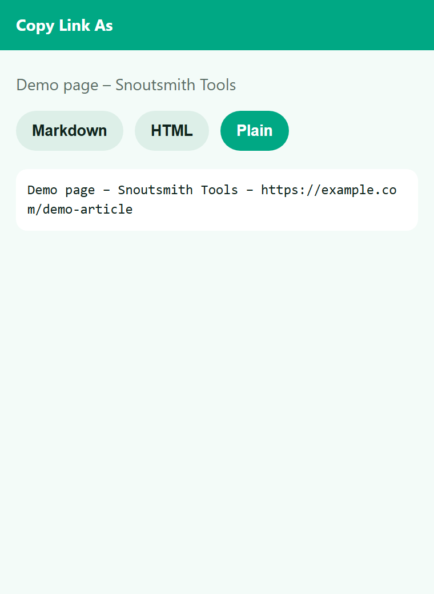

# Copy Link As – Markdown, HTML, Plain

Copy the current page as a Markdown, HTML or plain-text link with one click.

Added feature: Remembers your favourite format (added feature).

## Install

1. Download and unzip.
2. Open `chrome://extensions`, switch on Developer mode, click **Load unpacked** and pick the folder.
3. Pin the icon and click it.

## Permissions (and why)

- `activeTab` – read the title and URL of the current tab, only when you click the icon

No remote code, no tracking. See PRIVACY.md.

## License

MIT – see LICENSE.
