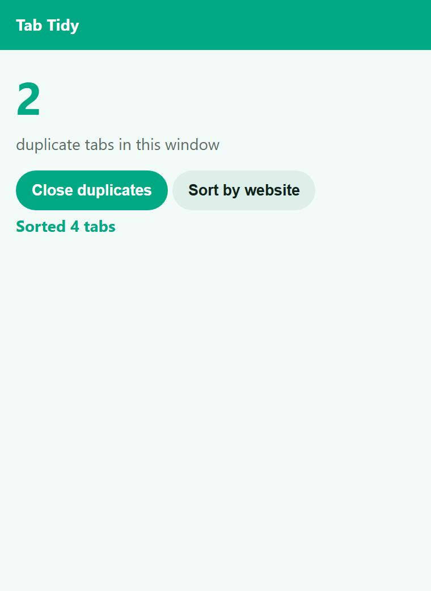

# Tab Tidy – Close Duplicate Tabs

Close duplicate tabs in one click and sort the rest by website.

Added feature: Sort tabs by website (added feature).

## Install

1. Download and unzip.
2. Open `chrome://extensions`, switch on Developer mode, click **Load unpacked** and pick the folder.
3. Pin the icon and click it.

## Permissions (and why)

- `tabs` – read the URL of open tabs to find duplicates and to sort them

No remote code, no tracking. See PRIVACY.md.

## License

MIT – see LICENSE.
