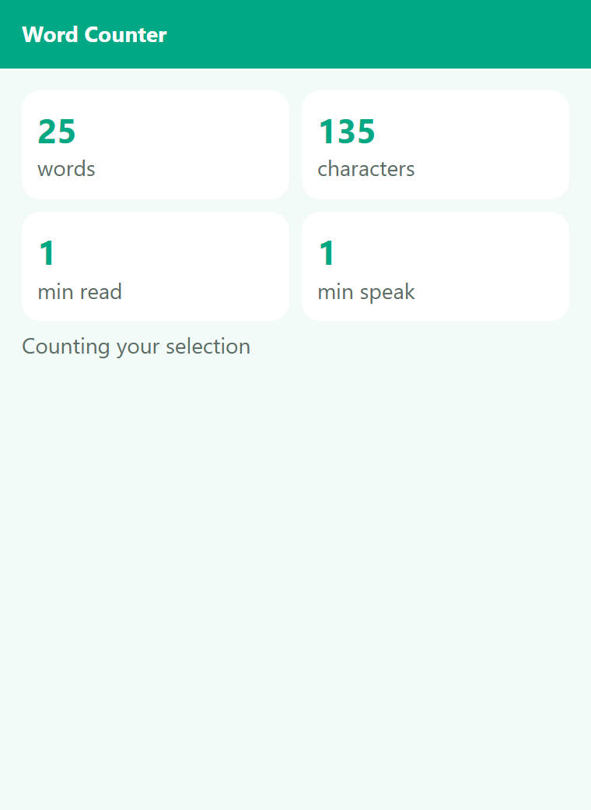

# Word Counter – Selection & Page

Count words, characters and reading time of the selected text or the whole page.

Added feature: Reading and speaking time (added feature).

## Install

1. Download and unzip.
2. Open `chrome://extensions`, switch on Developer mode, click **Load unpacked** and pick the folder.
3. Pin the icon and click it.

## Permissions (and why)

- `activeTab` – act on the current tab only after you click
- `scripting` – read the selected text (or the page text) to count it

No remote code, no tracking. See PRIVACY.md.

## License

MIT – see LICENSE.
